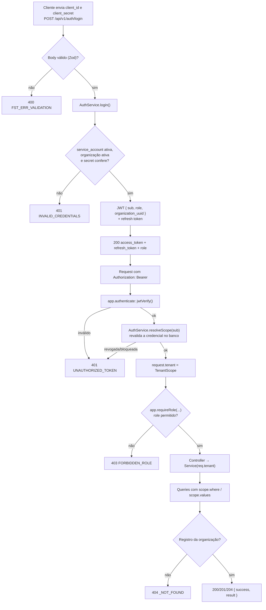
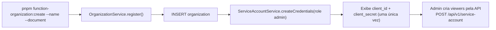
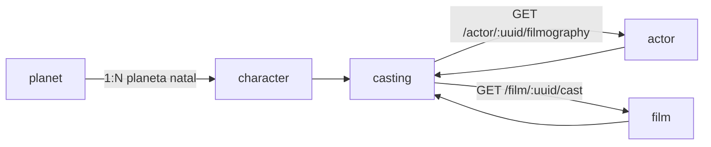

# Mapa de usabilidade do sistema

Fluxos atuais de autenticação e acesso da API.

## Autenticação por roles

Todas as credenciais autenticam pelo mesmo endpoint. O role vem da `service_account` e vai no JWT.

## Permissões

| Rota | admin | viewer |
| --- | --- | --- |
| `POST /auth/login`, `/auth/refresh`, `/auth/logout` | ✅ | ✅ |
| `GET /auth/me` | ✅ | ✅ |
| `/service-account` (criar, listar, revogar credenciais) | ✅ | ❌ 403 |
| `GET /<recurso>`, `POST /<recurso>/search`, `GET /<recurso>/:uuid` e as rotas de relação (`/filmography`, `/cast`) | ✅ | ✅ |
| `POST /<recurso>`, `PATCH /<recurso>/:uuid`, `DELETE /<recurso>/:uuid` | ✅ | ❌ 403 |

`<recurso>` = `planet`, `character`, `actor`, `film`, `casting`. Sempre restrito à organização da credencial.

## Cadastro de organização (CLI)

## Relações do domínio de exemplo

