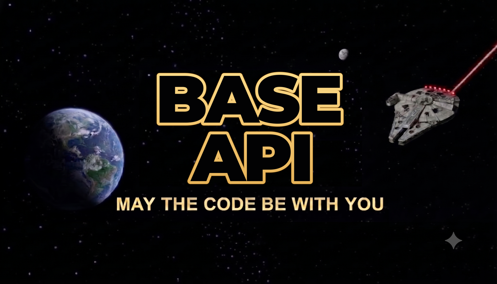

# base-api

<p align="left">
  
</p>

> _"A Forca do Codigo esta viva neste projeto."_ — Mestre Jedi do Backend

base_api e uma API REST em Node.js e TypeScript que serve de exemplo e ponto de partida para novos backends: autenticacao, isolamento por organizacao, paginacao com filtros dinamicos, documentacao automatica e testes, tudo funcionando sobre um dominio de exemplo do universo Star Wars.

---

## Missao Jedi

Este projeto foi criado para ser uma base de padronização de uma estrutura de API. Ele carrega o padrão **backend-node-pk** (o mesmo do `nota_stack_api`), sem nenhum core de negócio específico: clone, troque o domínio de exemplo pelo seu e comece a missão.

## Conselho Jedi (Equipe)

| Posto                    | Membro                                         |
| ------------------------ | ---------------------------------------------- |
| **Mestre Jedi (Author)** | [@patricklohn](https://github.com/patricklohn) |
| **Cavaleiro Jedi**       | [@]()                                          |

### O que ele oferece hoje

- Autenticacao JWT por roles (`admin` escreve, `viewer` só lê) com credenciais em `service_account`
- Isolamento multi-tenant por organização centralizado (`TenantScope`) e reforçado no banco (FKs compostas)
- Login por `client_id`/`client_secret` com access token JWT e refresh token rotativo (body ou cookie `httpOnly`), pronto para frontends — [docs/auth.md](docs/auth.md)
- Gestão de credenciais pela API: criar `viewer`/`admin`, listar e revogar na hora
- CRUD completo de exemplo (criar, consultar, listar com `condition`, editar, remover) com tabelas correlacionadas — [docs/domain.md](docs/domain.md):
  - `planet` 1:N `character` (planeta natal)
  - `actor` N:N `character` N:N `film` via `casting` (elenco)
  - Endpoints com join: filmografia do ator, elenco do filme, detalhe com relações resolvidas
- Paginação padronizada com filtros dinâmicos (`and`/`or` aninhados, `in`, `ilike`, `is null`, comparação entre colunas) — [docs/pagination.md](docs/pagination.md)
- Soft delete, regras de integridade (409 ao remover registro em uso) e auditoria de toda escrita em `audit_log`
- Seed com a saga de demonstração: 8 planetas, 12 personagens, 14 atores, 8 filmes e 43 participações
- Persistencia segura em PostgreSQL (ou Supabase) via Kysely
- Documentacao automatica via Swagger UI + Scalar
- Segurança HTTP: Helmet, CORS, rate limit e health checks de liveness/readiness — [docs/security.md](docs/security.md)
- Testes unitários e de integração com Vitest, rodando no `pre-push` — [docs/testing.md](docs/testing.md)

### Roadmap (ainda nao implementado)

Próximos passos em [docs/planejamento/README.md](docs/planejamento/README.md). Destaques:

- CI de Pull Requests (GitHub Actions)
- Migração do ESLint para `eslint.config.js` (ESLint 10)
- Upload de arquivos e jobs agendadas como módulos opcionais

---

## Capacidades do Holocron

| Categoria           | Tecnologia                                    |
| ------------------- | --------------------------------------------- |
| Runtime             | Node.js 24 (`.nvmrc`) + TypeScript 5 (strict) |
| Framework           | Fastify 5                                     |
| Banco de dados      | PostgreSQL 18 (local via Docker) ou Supabase  |
| Query builder       | Kysely (type-safe)                            |
| Validacao           | Zod 4                                         |
| Autenticacao        | JWT (access token) + refresh token rotativo   |
| Documentacao da API | OpenAPI / Swagger + Swagger UI + Scalar       |
| Observabilidade     | Pino + Sentry                                 |
| Testes              | Vitest (unitários e integração)               |

---

## Comecando a missao - Início rápido

```bash

cd base_api

nvm use

pnpm install

cp .env-example .env

# Edite .env com suas credenciais locais (JWT_SECRET: openssl rand -base64 48)

cp infra/dev/.env-example infra/dev/.env

pnpm docker:dev

pnpm migrate:latest

# Popula a organização "Jedi Archives" com a saga e imprime a credencial admin
pnpm migrate:seed 1_star_wars

pnpm server:dev
```

Abra `http://localhost:3000/docs`, faça login em `POST /api/v1/auth/login` com o `client_id`/`client_secret` impressos pelo seed e explore:

```bash
TOKEN=$(curl -s -X POST localhost:3000/api/v1/auth/login -H 'content-type: application/json' \
  -d '{"client_id":"adm_...","client_secret":"..."}' | jq -r .result.access_token)

# Atores ainda na ativa, nascidos antes de 1960
curl -G localhost:3000/api/v1/actor -H "Authorization: Bearer $TOKEN" \
  --data-urlencode 'condition={"type":"and","conditions":[{"column":"status","operator":"=","value":"active"},{"column":"birth_date","operator":"<","value":"1960-01-01"}]}'

# Filmografia de um ator (join casting × film × character)
curl localhost:3000/api/v1/actor/<uuid>/filmography -H "Authorization: Bearer $TOKEN"
```

---

## Protocolos da Frota - Scripts disponíveis

| Comando | O que faz |
| --- | --- |
| `pnpm docker:dev` | Sobe o Postgres local via Docker (usa `infra/dev/.env`) |
| `pnpm docker:dev:down` | Derruba o ambiente Docker de desenvolvimento |
| `pnpm server:dev` | Inicia o servidor em modo desenvolvimento |
| `pnpm build` | Compila TypeScript para `dist/` |
| `pnpm build:fast` | Build com tsgo, usado no `pre-push` (produção usa `pnpm build`) |
| `pnpm start` | Executa a API compilada (`dist/server/index.js`) |
| `pnpm lint` | Verifica problemas de lint (⚠ quebrado até migrar para `eslint.config.js`, ESLint 10) |
| `pnpm lint:strict` | Lint estrito, trata warnings como erro |
| `pnpm lint:fix` | Corrige automaticamente o que for possível |
| `pnpm typecheck` | Verifica tipos TypeScript sem gerar build |
| `pnpm typecheck:fast` | Typecheck com tsgo (TypeScript 7 nativo, ~4x mais rápido) |
| `pnpm test` | Testes unitários, sem banco (também roda no `pre-push`) |
| `pnpm test:watch` | Testes unitários em modo watch |
| `pnpm test:integration` | Testes de rota contra um banco descartável (precisa do Docker) |
| `pnpm format` | Formata o codigo com Prettier |
| `pnpm migrate:latest` | Executa migrations pendentes |
| `pnpm migrate:down` | Reverte a ultima migration |
| `pnpm migrate:seed <nome>` | Roda um seed específico de `src/database/seeds/` |
| `pnpm migrate:types` | Atualiza os tipos gerados do banco (`src/database/db/model.ts`) |
| `pnpm function-organization:create` | Cria uma organização e a credencial `admin` dela |
| `pnpm function-service-account:regenerate-secret` | Regenera o `client_secret` de uma credencial |
| `pnpm prepare` | Instala os hooks do Husky (roda sozinho no `pnpm install`) |

### O que cada script faz, em detalhe

- **`docker:dev`/`docker:dev:down`**: sobem/derrubam o Postgres local definido em [infra/dev/docker-compose.yml](infra/dev/docker-compose.yml). Precisam de um arquivo `infra/dev/.env` (copie de `infra/dev/.env-example`) com `DB_USER`/`DB_PASSWORD`/`DB_NAME`/`DB_PORT`.
- **`build`**: compila `src/` para `dist/` usando `tsconfig.build.json`.
- **`start`**: roda o build já compilado (`node dist/server/index.js`) — use depois de `pnpm build`, é o comando de produção.
- **`server:dev`**: roda a API direto do TypeScript com `tsx` em modo watch, resolvendo os path aliases (`@configs`, `@controllers`, etc.) em tempo de execução.
- **`migrate:seed`**: chama [src/database/db/seeds.ts](src/database/db/seeds.ts), que importa `src/database/seeds/<nome>.ts` e executa a função `default(db)` dele. Seed existente: `pnpm migrate:seed 1_star_wars`, que cria a organização `Jedi Archives` com a saga completa e imprime a credencial `admin`. Rodar de novo não duplica nada: se a organização já existir, ele só avisa.
- **`migrate:types`**: roda o `kysely-codegen` e regenera `src/database/db/model.ts` a partir do schema real do banco, preservando os ajustes manuais (enums, `ColumnType`).
- **`function-organization:create`**: script de admin, roda fora da API, para criar uma organização e a primeira credencial dela, com role `admin` (`--name`, `--document`). As demais credenciais são criadas pela própria API (`POST /api/v1/service-account`).
- **`function-service-account:regenerate-secret`**: script de admin, roda fora da API, para gerar um novo `client_secret` de qualquer credencial (`--client_id`). O secret anterior e os refresh tokens da credencial deixam de valer.
- **`prepare`**: instala os hooks do Husky; o pnpm roda sozinho depois do `install` ([docs/git-hooks.md](docs/git-hooks.md)).

---

### Convencoes aplicadas

- Naming de simbolos via ESLint:
- variaveis e functions em `camelCase`
- classes em `PascalCase`
- types ou interfaces em `PascalCase` porem com o pre frefixo de `i` para interface
- constantes exportaveis podem usar `UPPER_CASE`
- constantes que esperamos valores BOOLEANOS precisamos do prefixo `is`, `has` ou `should`
- Naming de arquivos via ESLint por camada:
- controllers, services, errors, middlewares, plugins, providers e enums em `kebab-case.ts`
- Typecheck completo disponivel via `pnpm typecheck`

Lista completa e detalhada de todos os padroes do projeto: [README-PATTERNS.md](README-PATTERNS.md).

### Branches e commits

Em português, no padrão Conventional Commits. A branch descreve a demanda (`tipo/contexto-da-demanda`) e cada commit é uma etapa dela (`tipo(escopo): descrição`).

- Branch: `feat/crud-de-naves`
- Commits: `feat(starship): adiciona migration e schema da nave`, `feat(starship): adiciona rotas de cadastro e listagem`

Tipos, escopos e regras completas: [README-PATTERNS.md](README-PATTERNS.md#padrão-de-branch-e-commit). Os hooks do Husky validam a mensagem do commit e rodam typecheck, testes e build antes do push: [docs/git-hooks.md](docs/git-hooks.md).

---

## Holocron de missões futuras

Documentação do que já existe (docs/):

- [Domínio de exemplo (Star Wars) e como trocá-lo pelo seu](docs/domain.md)
- [Autenticação: access token, refresh token e roles](docs/auth.md)
- [Paginação e filtros dinâmicos](docs/pagination.md)
- [Hooks de Git (Husky)](docs/git-hooks.md)
- [Segurança HTTP e health checks](docs/security.md)
- [Testes (Vitest)](docs/testing.md)
- [Padroes do projeto](README-PATTERNS.md)

Planejamento e próximos passos: [docs/planejamento/README.md](docs/planejamento/README.md).

## Holocron mapa intergalatico!

- [Mapa de usabilidade do sistema](README-MIND-MAP.md)

---

## Codigo do Conselho Jedi

- Testes sao a Forca que mantem o projeto inteiro estavel (ver [docs/testing.md](docs/testing.md)).
- Segredos ficam no .env, nunca no repositorio.
- Regras de negocio vivem em Services e Rules; Controllers apenas orchestram requests.
- Documente novos endpoints no proprio grupo de rota (docs.ts/validation.ts/example.ts).
- Migrations devem ser a forma unica de mudar o banco.
- Erros de dominio devem usar ServiceError para respostas previsiveis.

---

## Mandamentos do Código Jedi

- 🧠 Que a lógica esteja com você
- 🧪 Sem testes, você ainda não é um Jedi
- 🛠️ Use a força… do Clean Code
- 🐞 Sinta a perturbação: é um bug em produção
- 🧾 Faça ou não faça, não existe "TODO depois"
- 💻 O lado sombrio leva ao código legado
- 🔍 Seu foco determina sua realidade… e seus bugs
- 🚫 Não subestime o poder do git commit
- 🧹 Refatorar é o caminho para o lado luminoso
- 📦 Com grandes pacotes vêm grandes dependências
- ⚔️ Um Jedi usa o debugger, não o `console.log`
- 🛡️ O repositório bem protegido é o melhor escudo
- 🧬 O medo leva ao `any`, o `any` leva ao sofrimento
