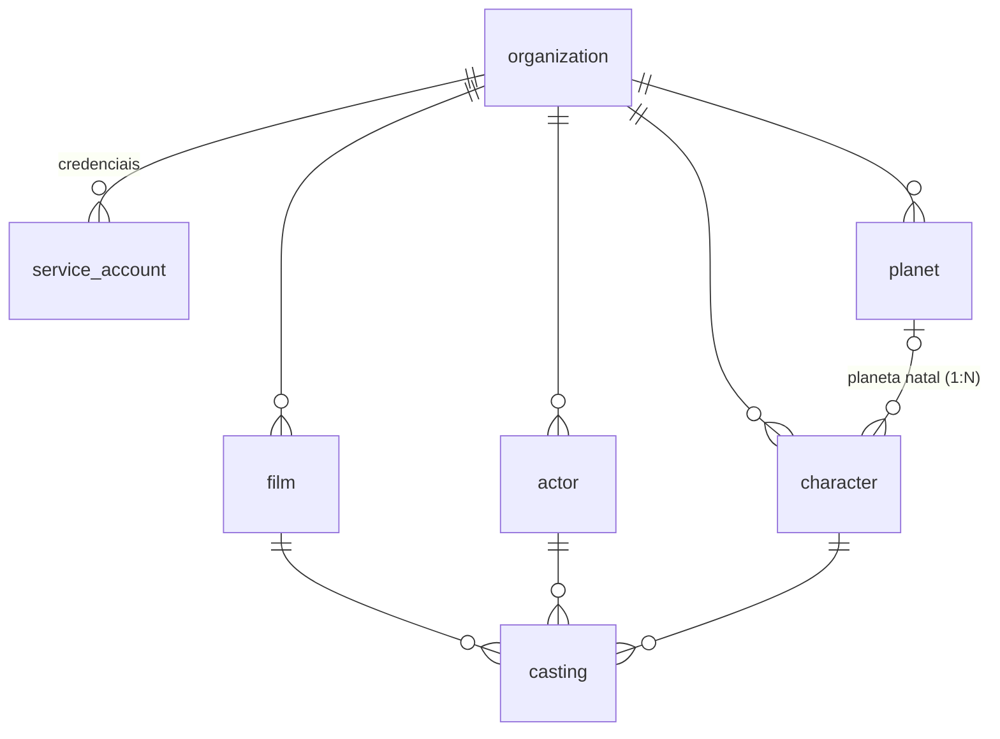

# Domínio de exemplo: a saga Star Wars

O domínio existe para demonstrar o padrão com dados reais: CRUD completo, relações 1:N e N:N, regras de integridade, joins e filtros. Toda tabela pertence a uma `organization` (tenant) e é acessada só pelo `TenantScope`.

## Modelo



| Tabela | O que é | Destaques |
| --- | --- | --- |
| `planet` | Planetas da galáxia | `region` com CHECK; nome único por organização |
| `character` | Personagens | `planet_uuid` opcional (1:N); `affiliation` com CHECK; `is_force_sensitive` |
| `actor` | Atores e atrizes | `birth_date` (`date`), `status` (`active`, `retired`, `in_memoriam`) |
| `film` | Filmes | `episode` 1–9 obrigatório na `skywalker_saga` e ausente na `anthology` (Zod no POST, CHECK no banco) |
| `casting` | Elenco (N:N) | liga filme + ator + personagem, com `role_type` (`main`, `supporting`, `voice`, `cameo`) |

Toda tabela tem `uuid` (uuidv7), `created_at`, `updated_at` (trigger) e `deleted_at` (soft delete).

## Integridade entre organizações

Cada tabela referenciada tem a unique `(uuid, organization_uuid)`, e as filhas usam FK composta para ela:

```ts
.addForeignKeyConstraint('casting_actor_fk', ['actor_uuid', 'organization_uuid'], 'actor', ['uuid', 'organization_uuid'])
```

Assim, mesmo um bug no service não consegue ligar o personagem da organização A ao filme da organização B: o banco recusa (`422 FOREIGN_KEY_VIOLATION`). As rules ainda checam antes, para cobrir o soft delete (a FK não sabe que o registro foi removido) e devolver um erro claro (`422 CASTING_ACTOR_NOT_FOUND`).

## Rotas

Leitura (`GET`, `POST /search`): roles `admin` e `viewer`. Escrita (`POST`, `PATCH`, `DELETE`): só `admin` (subgrupo com `requireRole`).

| Recurso | Rotas extras | Remoção bloqueada (409) quando |
| --- | --- | --- |
| `/api/v1/planet` | — | é planeta natal de algum personagem (`PLANET_IN_USE`) |
| `/api/v1/character` | `GET /:uuid` traz `homeworld` resolvido | está em algum elenco (`CHARACTER_IN_USE`) |
| `/api/v1/actor` | `GET /:uuid/filmography` | está em algum elenco (`ACTOR_IN_USE`) |
| `/api/v1/film` | `GET /:uuid/cast` (principais primeiro) | tem elenco (`FILM_IN_USE`) |
| `/api/v1/casting` | `GET /:uuid` traz filme, ator e personagem | — |

Os três jeitos de trazer relação estão no código, para servir de referência:

- **Subquery `jsonObjectFrom`** (`CharacterService.findById`): o pai com um objeto aninhado, sem duplicar colunas.
- **Join + `jsonBuildObject`** (`ActorService.filmography`, `FilmService.cast`, `CastingService.findById`): uma linha por relação, com os lados resolvidos.
- **Filtro `condition`** (`POST /character/search` com `planet_uuid`): a listagem paginada já é a "lista de filhos".

## Seed

`pnpm migrate:seed 1_star_wars` cria a organização `Jedi Archives` (CNPJ `11.222.333/0001-81`) com 8 planetas, 12 personagens, 14 atores, 8 filmes (episódios I a VII e Rogue One) e 43 participações, e imprime a credencial `admin`. Exemplos que ele permite:

- Darth Vader tem dois atores no mesmo filme: David Prowse (`supporting`) e James Earl Jones (`voice`).
- Hayden Christensen interpreta dois personagens (Anakin e Vader) em Revenge of the Sith.
- Tatooine não pode ser removido: é o planeta natal de Luke, Anakin e Vader.

## Trocando pelo seu domínio

1. Apague as migrations `05` a `09`, os módulos `planet`, `character`, `actor`, `film`, `casting` (rotas, controllers, services, rules, schemas e testes) e o seed.
2. Remova as tabelas de `TENANT_COLUMNS`, de `REQUIRED_TABLES` (`codegen.ts`), do `model.ts`, de `tAuditEntity` e das tags do Swagger.
3. Crie o primeiro módulo seguindo o roteiro de [README-PATTERNS.md](../README-PATTERNS.md#criando-um-módulo-novo), usando `actor` como modelo.
